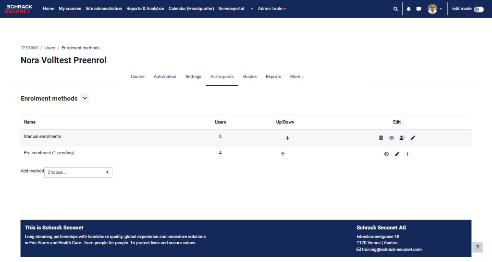
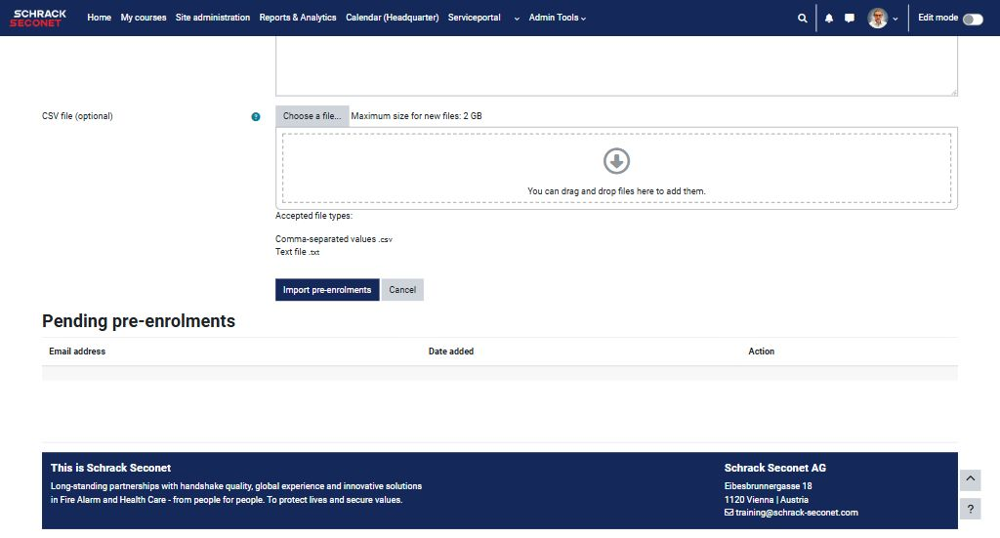
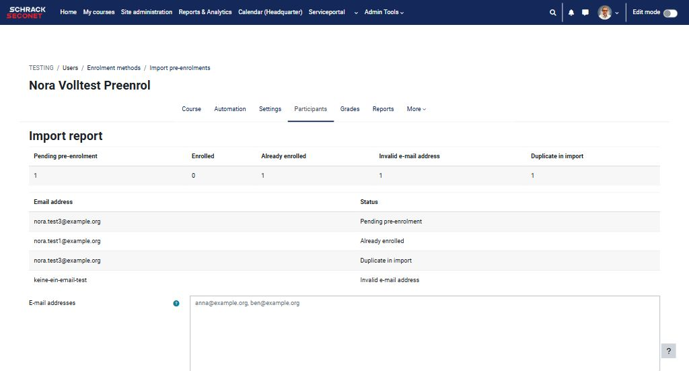
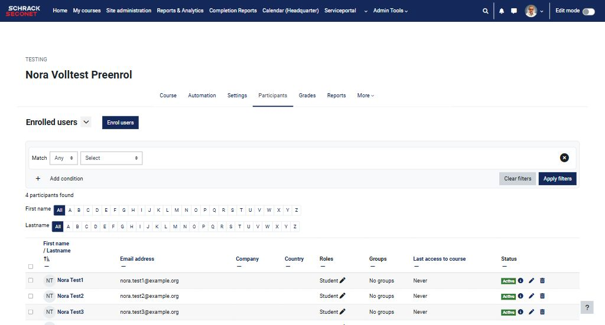
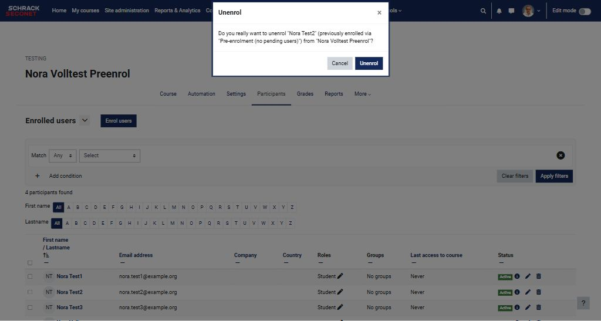

# Pre-enrolment (email list) — Support & Documentation

**Moodle plugin:** `enrol_preenrol` · Version 1.0.2 · Moodle 4.1–5.3 · GPL v3

 

- 🐞 **Report a bug / request a feature:** use the [Issues tab](https://github.com/stadtschamane/enrol_preenrol-support/issues)
- 📦 **Buy the plugin:** Moodle Marketplace — licence model: *one-time payment, lifetime updates*
- 🔐 The plugin code repository is **private** (kept closed by the maintainer). Marketplace purchases ship the complete GPL v3 source code with the plugin. This public repository is the support and documentation point.

---

## What the plugin does

**Pre-enrolment (email list)** lets course managers enrol people into a course by importing a list of e-mail addresses before those people have a Moodle account. As soon as an account with a matching address is created for the first time (self-registration with admin confirmation, automated SAML/ADFS account creation, or web service), the person is enrolled automatically — a normal course enrolment, fully compatible with groups, activity restrictions, completion and grades.

**Key features:** bulk import via pasted list or CSV/TXT upload · detailed 5-category import report (pending / enrolled / already enrolled / invalid / duplicate) · idempotent re-import · standard Edit/Unenrol controls for enrolled users · pending-list management with single-row deletion · Privacy API support · Moodle 4.1–5.3 (CI-verified: PHP 8.1–8.3, MariaDB + PostgreSQL).

| | |
|---|---|
| Plugin type | Enrolment method (`enrol_preenrol`) |
| Supported Moodle versions | 4.1 – 5.3 |
| Licence | GPL v3 (full source ships with every purchase) |
| Data stored | E-mail addresses of the pending list until first account creation; deleted via Privacy API |
| Database table | `enrol_preenrol_pending` (unique per enrol-method + e-mail) |

---

## How it works — the flow

1. **Add the method** in your course (role, duration, dates — all standard Moodle fields).
2. **Import your list** via the + icon: paste one e-mail per line (comma/semicolon/tab also fine) or upload a .csv/.txt file.
3. **Read the report:** every import shows a 5-category result per address — *Pending / Enrolled / Already enrolled / Invalid / Duplicate*. Re-importing the same list changes nothing (idempotent).
4. **People get enrolled automatically** the moment their account is created — no manual step, ever.
5. **Manage afterwards:** enrolled people use the standard Edit/Unenrol icons; the pending table supports single-row deletion at any time.

### Screenshots

Enrolment methods page with the Pre-enrolment instance (pending counter + import icon):

Import page with field-level help (?), CSV/TXT upload and the pending table:

Import report — all 5 categories, one line per address:

The automatic enrolment, live-verified with a real signup through the e-mail-confirmation flow:

The standard unenrol confirmation dialog — pre-enrolled users stay fully manageable:

---

## Pricing

- **One-time payment, lifetime updates** — every future release of the plugin is included.
- Sold and transaction-handled through the official [Moodle Marketplace](https://marketplace.moodle.com).
- Purchases include the full GPL v3 source code.

## Issues & support

Please use the [issue tracker](https://github.com/stadtschamane/enrol_preenrol-support/issues) with the provided templates — bug reports get version numbers and Moodle/PHP details, feature requests are triaged by upvotes. Response window: usually within a few days.

---

*Pre-enrolment (email list) for Moodle — maintained by Stadtschamane.*